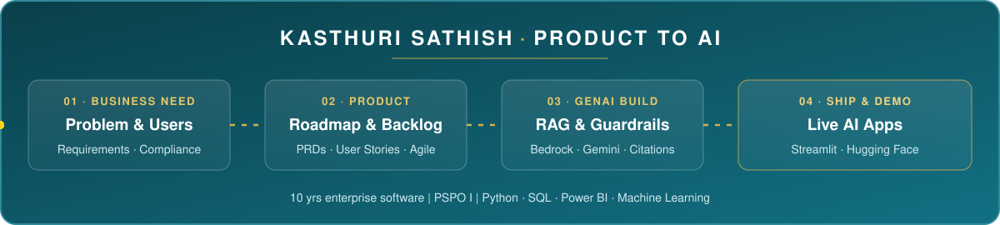

  

<h3 align="center">Hi 👋, I'm Kasthuri Sathish</h3>

  
  
  

- 🚀 **Senior Product Owner** (10 yrs enterprise software) turning business & compliance needs into **GenAI & ML** apps.
- 🤖 Building with **RAG**, **Prompt Guardrails**, **AWS Bedrock (Claude 3)** & **Gemini 1.5 Flash**.
- 🔭 All 6 end-to-end **Data Science & AI** projects are pinned below (**Python · SQL · TensorFlow · Scikit-Learn · Power BI**).
- 💬 Ask me about **Product Ownership & Management, GenAI, Streamlit & Hugging Face**.
- 📫 Reach me at **kasthuri.vision@gmail.com**
